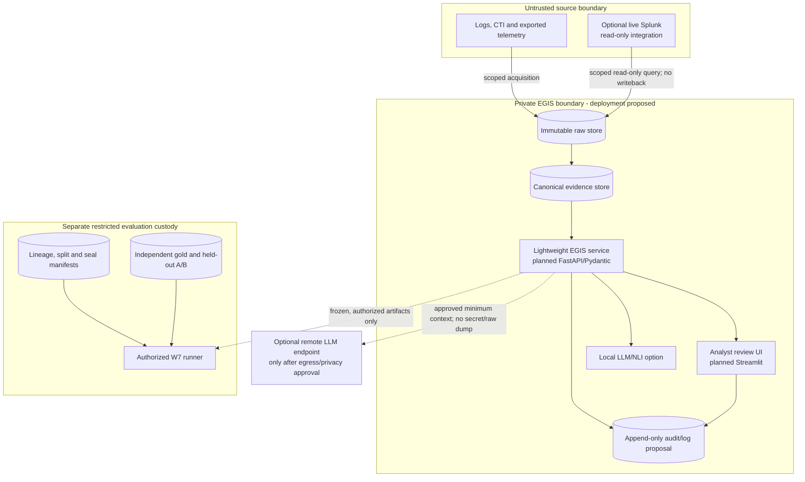
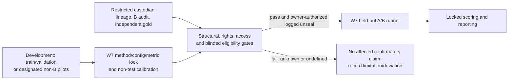

# EGIS-SOC architecture v1.0 — W1-09 design

**Status:** APPROVED as the W1-09 Week 1 architecture/design deliverable by the project owner on 2026-10-17 under [D-014](context/DECISION_LOG.md). The stage contracts are planned designs, not a deployed service, a live Splunk connection, a dataset seal, or experimental evidence. The [approved protocol v0.2](research-protocol.md), [annotation guideline v1.0](annotation-guidelines.md), and scoped W1-07 [split/freeze framework](split-freeze-policy.md) govern this document. [D-008](context/DECISION_LOG.md) governs W6/W7 order where the earlier [source plan](EGIS_SOC_Ke_hoach_8_tuan.md) differs. W1-07's operational choices in policy §13 remain pending owner review.

## 1. Scope and implementation state

Input is an **already triaged, bounded incident** with permitted alerts and telemetry. Output is an analyst-reviewable report with atomic factual claims, evidence references, three-class verification, uncertainty, omission warnings, and an audit trail. Unbounded detection, autonomous remediation, attribution without evidence, and production SOC deployment are outside scope. Raw logs and CTI are untrusted content even when retrieved from an approved source.

The repository currently contains W1-03 [Pydantic contracts](../src/egis_soc/schemas.py) and a scoped W1-07 **synthetic in-memory** lineage, split, integrity and evaluation-boundary prototype ([review](w1-07-code-review.md)). The W1-03 strict-JSON repair is separately accepted under D-013. No ingestion adapter, retrieval index, generation/verifier pipeline, report schema, authenticated service, UI, private store, real-data provenance verification, or deployed ACL is established by those deliverables. W1-05 [source assessment](datasets/acceptance-handoff.md) is documentation only: O1 is reserved/metadata-only, and Splunk Attack Range is B-reserved but unqualified. No real split, independent Environment B, adequate cluster count, or held-out access is established.

## 2. Logical pipeline and trust boundaries

```mermaid
flowchart LR
    T[Already triaged alerts and telemetry<br/>optional read-only Splunk export] -->|authorized scoped read| I[W2 ingestion and normalization]
    I --> R[(Private immutable raw snapshots<br/>and provenance)]
    I --> E[(Private canonical evidence<br/>and incident references)]
    E --> Q[W3 incident-scoped retrieval<br/>structured filters + BM25]
    Q --> G[W5 structured LLM draft]
    G --> A[W5 atomic claim segmentation]
    A --> V[W3-W4 hybrid verification<br/>rules + NLI]
    V --> C[W5 S2 evidence-based handling<br/>remove, qualify or correct unsupported claims]
    C -->|verified S2 final report and trace| S[Archive shared S2 state]
    S --> J{S2 or S3 fork}
    J -->|S2 unchanged| H[Analyst review]
    J -->|S3 only| O[W5 operational fact inventory<br/>from permitted evidence only]
    E -->|same permitted snapshot| O
    O --> M[W5 omission match and controlled repair<br/>from archived S2 state]
    M -->|all changed claims and citations| RV[Re-verify S3 changes<br/>same rules + NLI contract]
    RV -->|further eligible repair; within round cap| M
    RV -->|cap, completion or review required| H
    M -->|cap or no eligible repair| H
    H --> U[(Private report and audit record)]
    X[(Restricted evaluation gold,<br/>lineage, split and test artifacts)] -->|authorized W7 scoring only| Y[W7 evaluation runner]
    U -.->|only after W7 gates; scoped archived output| Y
    E -.->|custodian-controlled held-out snapshots only| Y
```

S2 includes evidence-based removal, qualification or correction of unsupported claims before its final report and trace are archived. The S2 branch then returns that archived report unchanged; only S3 builds and consumes the operational inventory and performs extra omission/repair work. S3 re-verification follows the same verifier contract but never creates a new S2 fork. The loop is bounded by the pre-test repair policy, at most two additional iterations. A candidate citation or fact never gains support merely by passing through the diagram.

**Boundary rules (design requirements, not implemented security):** The source adapter uses only an owner-authorized read-only account and bounded query; it never writes to Splunk or executes remediation. Private raw and normalized stores need separate least-privilege credentials, encryption/retention decisions, access logs, immutable snapshots and tenant/incident filtering **at every read**, not merely in a prompt. A remote model placement requires a separate privacy, rights and egress decision; local placement avoids that remote transfer but still needs resource limits and input/output audit. No LLM receives direct store credentials, arbitrary network/tool access, held-out gold, or cross-incident search. A local model is an inference component here, not a substitute for owner approval. Restricted gold/test custody and authenticated W7 access require external enforcement: W1-07 in-process checks, hash strings and role labels alone are not authentication or OS isolation.

## 3. Existing W1-03 data contract and planned additions

| Existing validated model | Exact current fields relevant here | Boundary and limit |
| --- | --- | --- |
| `EvidenceProvenance` | `source`, `timestamp_utc`, `raw_message`, `raw_message_ref`, `sha256`, `acquisition_method` | `sha256` is specified for exact persisted raw snapshot bytes before decoding/normalization; W2 must verify bytes at the opaque `raw_message_ref`. Matching bytes do not attest source truth. The source store is external to this schema. |
| `EvidenceEvent` | `evidence_id`, `incident_id`, `tenant_id`, `normalized_fields`, `provenance` | Strict JSON `normalized_fields` are detached and read-only after validation. Original raw event and provenance stay immutable; transformations need separate lineage. |
| `IncidentBundle` | `incident_id`, `tenant_id`, `environment_id`, `source_dataset`, `scenario_family`, `alert_ids`, `evidence_ids` | Inference-facing references only; `check_scope` rejects foreign tenant/incident or unknown evidence IDs. It has no gold facts or embedded event list. |
| `ClaimEvidencePair` | `pair_id`, `incident_id`, `tenant_id`, `claim`, `evidence_ids`, `claim_type`, `label`, `annotation_source`, `claim_source` | A labeled training/diagnostic pair, **not** a generated report claim or evaluation gold by itself. Decided labels require evidence IDs. |
| `GoldFact`, `EvaluationGoldRecord`, `EvaluationClaimEvidencePair` | Human-reviewed evaluation fact/record/pair models; evaluation pair adds `annotation_record_id` and requires `annotation_source="human_reviewed"` | Evaluation-only storage and access. A valid model or `human_reviewed` string is not proof of independent annotation, blinding or custody. `EvaluationGoldRecord.check_scope` requires the same incident, tenant and evidence snapshot. |

**Planned, separate interfaces:** versioned retrieval result, structured draft/report, emitted citation list, atomic claim record, verifier trace with `review_required`, operational fact inventory, omission match, S2 fork archive, repair action, analyst decision and audit record. These are *not* fields or classes in W1-03. Before implementation, W5 must define their schemas, canonical serialization, exact claim/citation identity, size limits and failure outcomes against permitted evidence. W1-07 proposes private lineage/manifest sidecars rather than silently adding fields to W1-03; policy §13 approvals and trusted storage are still required. The output report structure is a design goal from the source plan, not an existing API contract.

## 4. Stage contracts

The planned owner is a work phase, not a claim of completed code. Every handoff carries incident/tenant identity, artifact/config version, and an audit correlation reference in the **planned stage envelope**; this envelope is not a W1-03 field. Failures are retained for review rather than silently omitted from study denominators.

| Stage and planned owner | Input → output | Scope, invariant and failure handling |
| --- | --- | --- |
| **1. Acquisition and normalization — W2** | Authorized already triaged incident boundary plus approved telemetry export → exact raw snapshot in private store, verified provenance, normalized `EvidenceEvent` records and `IncidentBundle` references. | Read-only source credentials; rights/privacy and source-event/run lineage must be cleared before acquisition. Verify `sha256` against persisted raw bytes, preserve originals, UTC conversion and transformation history; assign stable IDs without inferring source truth. Missing rights, missing raw bytes, digest mismatch, or uncertain incident boundary/provenance → quarantine and audit; no fabricated event. No live Splunk connection is authorized by this design. |
| **2. Evidence store and retrieval — W2/W3** | Validated `IncidentBundle`, caller scope and query → ordered, versioned evidence IDs, passages and retrieval trace. | Authenticate caller in host service; filter tenant **and** incident plus permitted bundle IDs before structured/BM25 ranking, then recheck each returned `EvidenceEvent` with `check_scope`. No cross-partition held-out read for development. Unknown IDs, scope mismatch, absent index, oversized content or timeout → fail closed and log; do not widen query. Embeddings are optional, not required by v1. |
| **3. Structured generation — W5** | Fixed retrieved evidence/context and versioned LLM/prompt/decoding policy → structured draft with text spans, provisional citation IDs and uncertainty. | Same permitted evidence snapshot; raw/CTI text is delimited as data. Never obey instructions inside evidence. No direct tool, store or network privilege for the model. Validate output size/shape and citation IDs; on malformed, uncited or timed-out output retain the draft/failure and route to review. A citation ID is only a reference, not support. |
| **4. Atomic segmentation — W5** | Draft factual assertions and spans → atomic claim candidates with modality and emitted citations (planned record). | Preserve negation, time, actors, quantities and uncertainty; do not hide a second unsupported atom in a compound sentence. Citation validity, relevance and semantic support are separate checks. Ambiguous segmentation → human adjudication/review; do not assign a forced label. |
| **5. Claim verification and S2 evidence-based handling — W3/W4 verifier, W5 report** | Atomic claim and fixed *permitted* evidence set → `supported`, `contradicted` or `insufficient`, citation checks, rule/NLI trace and separate review flag; then S2 report with unsupported claims removed, qualified or corrected from that evidence. | Check citation scope and relevance independently from factual support; assess the full permitted combination. For E1/RQ1/RQ3, label against the fixed pair evidence set only; for E2/RQ2 output support, use the fixed permitted incident evidence, cited or uncited, and judge emitted citations separately for CSA. Missing evidence is **insufficient**, not contradiction. Only full factual support merits `supported`; a direct, unambiguous refutation is needed for `contradicted`. Recheck any materially changed S2 factual claim against the same permitted evidence before archiving the final S2 report and trace. Unresolved disagreement/low confidence → review routing, with the protocol's prediction mapping fixed before test. V3 combines deterministic checks with the same NLI checkpoint/thresholds as V2 in the primary matched comparison. Error or timeout → recorded failure/review, never silent support. |
| **6. S3 operational fact inventory and omission match — W5** | After the S2 archive, same permitted inference evidence/metadata, plus archived S2 report for matching → versioned candidate facts and uncovered eligible operational candidates with evidence links. | Only S3 constructs the operational inventory, independently of the generated report and from permitted evidence **only**; it cannot read `GoldFact`, `EvaluationGoldRecord`, gold IDs, labels or adjudications. S2 neither constructs nor consumes it. A candidate without support/observability cannot trigger a confident repair. Missing or ambiguous coverage → review warning, not an invented gold omission. Independent human gold construction for CFR remains in restricted evaluation custody. |
| **7. Controlled repair and re-verification — W5** | Archived S2 state, failed claims, eligible uncovered operational facts and fixed evidence → S3 revision/actions, all changed or added claims re-verified, bounded trace. | S2 terminates at the shared archive; S3 forks from the **identical hashed S2 state**. Remove, qualify, rewrite, add supported fact or abstain; never invent evidence or promote insufficient evidence to support. At most two extra iterations under a locked policy. Recheck every changed claim and citation. Cap, support failure or timeout → stop, preserve warnings and send to analyst. |
| **8. Analyst review and audit — W5/W8** | Verified S2/S3 report, evidence links, warnings and stage traces → analyst decision, edits, final report version and audit record. | A human sees source evidence and unresolved warnings; approval is an explicit recorded action, not automatic remediation. Review UI enforces same tenant/incident access and logs evidence openings, edits and decisions. Analyst edits create a new version and trigger claim/citation recheck as needed; the raw store is never rewritten. Authentication, retention and breach handling are pending deployment decisions. |
| **9. Restricted evaluation — W7** | Sealed manifests, independent human labels/facts, locked methods and authorized archived outputs → per-arm records and prespecified metrics. | Separate custodian/runner ACL and logged unseal after all gates in §5 below. No test/OOD content, IDs, labels, scores or gold-derived prompts flow to development for tuning. Failure/undefined endpoint follows approved protocol and locked missing-output policy; no adaptive replacement or denominator change. |

## 5. Research and evaluation boundary

- **W1-07/W2 custody:** Maintain private source/rights and lineage records for original incident, run, concrete template, collection, source event, raw snapshot and descendants. Group linked components, audit overlap across train, validation, held-out A/B and quarantine unresolved material links. D-012 accepts a design and synthetic prototype only; actual rights, operator, provenance, split, independent B, ACL and seal remain unverified. O1 stays reserved/metadata-only and the proposed Splunk B channel stays out of development. A renamed host or schema is a perturbation, not independent B.
- **W5 primary pair preparation:** Fix generator, retrieval/evidence snapshot, prompt, decoding, seed, cap and pairing rule on permitted development material. Held-out arm-independent drafts/pairs, when authorized, stay with restricted custody and are independently human-labeled before V2/V3 inference. Source-derived pilots and actual V3-directed S3 repair claims cannot replace the primary frozen draft-derived RQ1/RQ3 pair population. V2/V3 receive identical ordered claims, permitted serialized evidence, NLI checkpoint and shared thresholds; the policy's planned exact-input/digest guard is not yet a verifier run.
- **W5 S2/S3 fork:** Archive one hashed retrieval/draft/verification/S2-report state per incident; S3 alone adds operational omission checking and controlled repair. Both arms use the same held-out incident set and evidence access. Missing or differing fork states fail confirmatory paired eligibility under the locked policy. Independent evaluation gold facts are assembled blind to draft, arm, predictions and S3 operational inventory. Evaluation output annotators are blind to S2/S3 identity.
- **W6 then W7:** W6 permits B preparation, rights/independence/lineage audit and non-test profiling/development only. W7 locks methods/configuration/statistics, performs non-test calibration and required structural/access audits, then obtains post-lock blinded class/denominator eligibility pass/fail; exact held-out counts remain restricted. Only an authorized, logged unseal allows conditional held-out A/B evaluation. Failed/inconclusive calibration, inadequate independent units, rights/lineage failure or undefined required endpoint makes the affected RQ exploratory. No Environment B independence, adequacy or statistical calibration is claimed here.
- **Metric integrity:** RQ1 is V3 versus V2 on matched pairs/evidence/NLI; RQ2 is S3 versus S2 on matched incidents with CFR and pooled UCR primary gates plus CSA and introduced-claim diagnostics; RQ3 needs independently sourced B and the approved relative F1/SP drop gates with mandatory descriptive absolute B and FSR reporting. Keep the exact S/C/I labels and approved denominators. Needs Review is routing, not a fourth label. Gold critical facts are independent human annotations; operational facts never become evaluation gold automatically. Preserve negative and undefined results.

## 6. Open owner decisions and validation ownership

| Decision or evidence gap | Proposed owner and gate |
| --- | --- |
| Rights/privacy for each artifact, O1 role, Splunk B screening channel, actual source operator and collection lineage; any live Splunk read-only account and query scope | Project owner and W1-05/W2 rights reviewers **before acquisition or connection**. Current source matrix is metadata only. |
| W1-07 policy §13 sidecar keys/equivalence, near-duplicate disposition, assignment/seed, roles, trusted manifests, storage ACL/authentication, sign-off, B structural release, N-01–N-04 and breach handling | Project owner and restricted custodian **before real split/freeze or annotation/evaluation access**. |
| W5 report/citation/trace schemas, operational inventory procedure, arm-independent draft/pair configuration, claim cap/sampling/pairing, S2 fork and repair policy | W5 implementation with owner-approved pre-test lock; validate on permitted non-test material only. |
| W7 exact configuration/metric/failure locks, independent B and cluster adequacy, non-test CI calibration, eligibility, sealed gold/pairs and unseal authority | W7 runner, custodian, independent reviewer and owner, in the approved D-008 order; failure blocks affected confirmatory inference. |

Architecture validation should include synthetic scope/ACL denials, raw-byte digest and lineage checks, untrusted-log injection cases, citation relevance/support separation, S/C/I and omission edge cases, repair re-verification/cap, S2 fork identity, sealed-gold isolation and W7 gate failure paths. These are **planned tests**, not executed tests or proven controls. The companion W1-06 threat model owns the adversarial case inventory; W2/W3/W4/W5/W7 own implementation-specific checks before their respective acceptance gates.
